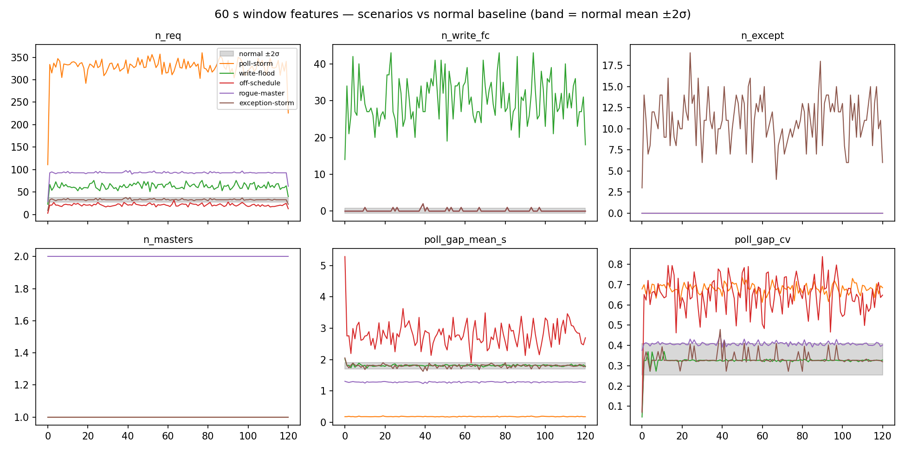
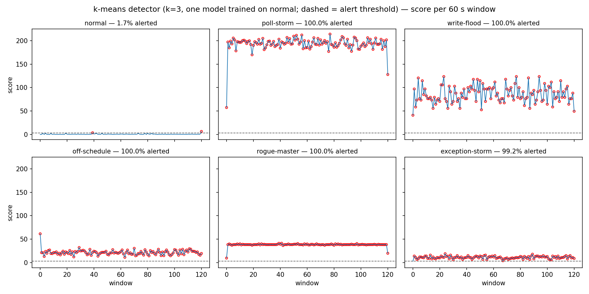
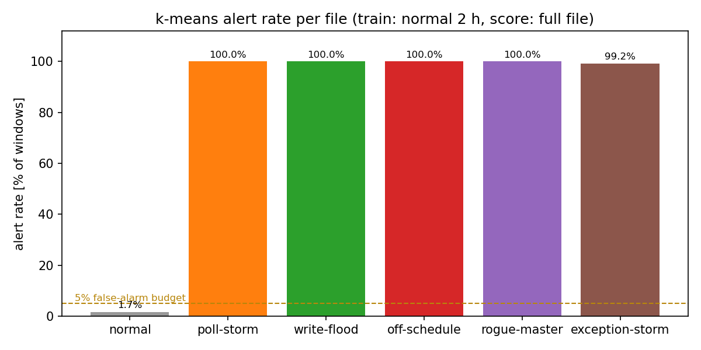

# k-means anomaly detection — results

One-class k-means over 60 s windows of Modbus TCP traffic: learn what
*normal* polling looks like, flag every window that lands far from the
learned baseline. Method, feature list and the k/threshold rationale are in
[`detect-kmeans.md`](detect-kmeans.md); this page shows what the pipeline
produces and how to reproduce it.

**Pipeline:** lab (or offline simulator) → pcap/events → `featurize.py` →
`windows.csv` (pinned 13-column schema, one row per 60 s window) →
`detect_kmeans.py` → `alerts CSV` (`window_id,score,alert`).

## How to reproduce

```sh
# offline: 6 traffic scenarios x 2 h, featurized (no lab/docker needed)
cd lab && just sim-all 2

# one model trained on the normal reference; every scenario file scored as-is
mkdir -p data/results
python3 detect_kmeans.py --in data/sim-normal-windows.csv \
    --train-file data/sim-normal-windows.csv \
    --out data/results/alerts-normal.csv --model-out data/results/model-normal.joblib
for s in poll-storm write-flood off-schedule rogue-master exception-storm; do
  python3 detect_kmeans.py --in data/sim-$s-windows.csv \
      --train-file data/sim-normal-windows.csv \
      --out data/results/alerts-$s.csv --model-out data/results/model-$s.joblib
done

# plots (reports/plots/*.png)
cd .. && python3 reports/make_results_plots.py
```

```sh
# real lab: capture 120 s of live Modbus TCP and featurize it
cd lab && just up && just capture 120 && just down
python3 featurize.py --pcap 'data/capture-*.pcap' --out data/windows-real.csv
```

## Detector

Trained on the normal reference file only (2 h = 121 windows, all 10 numeric
features, standardized with training statistics). On this real normal data
the silhouette rule picks **k = 3** (mean silhouette 0.826 ≥ 0.5); the alert
threshold is the 0.99-quantile of the training distances (**3.401**).
Synthetic selftest (`detect_kmeans.py --selftest`): recall 98% on injected
attacks, false-alarm rate 1.45% on normal.

## Scenario injection vs normal baseline

Window means, 2 h per file (`just sim-all 2` prints this table):

| scenario | traffic change | target feature | normal | scenario | divergence |
|---|---|---|---|---|---|
| poll-storm | poll interval ÷ 10 | `n_req` | 33 | 328 | ×9.9 ↑ |
| write-flood | FC6 write every ~2 s | `n_write_fc` | 0.12 | 30.2 | ×260 ↑ |
| off-schedule | poll gaps uniform 0.2–6 s | `poll_gap_cv` | 0.33 | 0.65 | ×1.9 ↑ |
| rogue-master | 2nd source IP at 1 s | `n_masters` | 1.0 | 2.0 | invariant breach |
| exception-storm | ~1/3 requests excepted | `n_except` | 0.0 | 11.0 | new signal |



## Detection results

One model (above), each file scored as-is via `--train-file`:

| file scored | windows | alerts | alert rate | mean score |
|---|---|---|---|---|
| normal | 121 | 2 | 1.7% | 0.6 |
| poll-storm | 121 | 121 | 100% | 193 |
| write-flood | 121 | 121 | 100% | 86 |
| off-schedule | 121 | 121 | 100% | 22 |
| rogue-master | 121 | 121 | 100% | 38 |
| exception-storm | 121 | 120 | 99.2% | 11 |




Notes on the numbers:

- The two normal alerts and the single exception-storm miss are borderline
  windows (e.g. the missed one has only 3 exception responses), consistent
  with the 1%-quantile threshold budget.
- off-schedule is the weakest injection (cv ×1.9; per-window distributions
  overlap normal tails) — it is still detected in every window here, but a
  cv-only detector would see marginal windows. poll-storm raises `poll_gap_cv`
  as a side effect (0.68), so `poll_gap_cv` alone cannot separate those two
  scenarios; the multi-feature distance handles it.

## Real-lab validation

120 s capture of the live containerlab lab (`just up && just capture 120`),
featurized with the same `featurize.py` (69 request/response pairs incl. one
operator setpoint write, 3 windows):

| feature (window mean) | real lab capture | simulator normal |
|---|---|---|
| `n_req` | 23 | 33 |
| `n_except` | 0.0 | 0.0 |
| `n_write_fc` | 0.33 | 0.12 |
| `n_masters` | 1.0 | 1.0 |
| `poll_gap_mean_s` | 1.78 | 1.80 |
| `poll_gap_cv` | 0.35 | 0.33 |

Captured windows land in the simulator's normal magnitudes (lower `n_req`
only reflects uneven window boundaries in the short capture), so features and
detector apply unchanged to live traffic.
